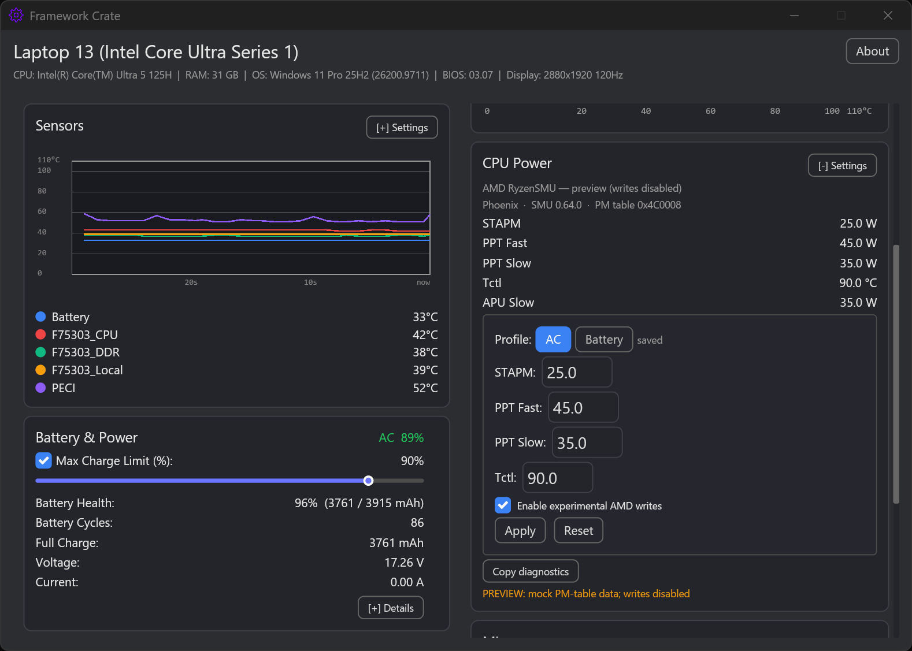

# Framework Crate (Windows)

[](https://github.com/vinctw22/Framework-Crate/actions/workflows/ci.yml)
[](https://github.com/vinctw22/Framework-Crate/releases)

[English](README.md) | **繁體中文**

專為 Framework 筆電設計的原生桌面 GUI：風扇控制、電池充電上限與即時硬體遙測。以 Rust 與 [Iced](https://iced.rs/) 0.14 打造，並透過 [`framework_lib`](https://github.com/FrameworkComputer/framework-system) 直接存取 EC。

專案網站（含隱私政策與授權）：https://vinctw22.github.io/Framework-Crate/

靈感來自 [ozturkkl/framework-control](https://github.com/ozturkkl/framework-control)。

## 下載

每個 [GitHub Release](https://github.com/vinctw22/Framework-Crate/releases) 都會附上預先編譯的 Windows 執行檔 `framework-crate.exe`，release notes 會列出該版本變更。

下載 `.exe` 後以管理員身分執行。PawnIO 為選用元件，只有 CPU Power 卡片需要；其他功能只要安裝 Framework EC 驅動即可運作。

## 螢幕截圖

<table>
  <tr>
    <td></td>
    <td></td>
  </tr>
  <tr>
    <td></td>
    <td></td>
  </tr>
  <tr>
    <td></td>
    <td></td>
  </tr>
  <tr>
    <td></td>
    <td></td>
  </tr>
  <tr>
    <td colspan="2" align="center"></td>
  </tr>
</table>

<p align="center"><strong>AMD CPU Power — 實驗性</strong>（預覽資料；寫入需開啟實驗性選項）</p>

## 功能

> 備註：0.9.6 新增實驗性 AMD RyzenSMU CPU Power（PM table 唯讀遙測、opt-in 寫入、AC／Battery profiles、診斷）、繁體中文 README／網站，並保留 0.9.5 的曲線／校準／匯出／托盤修正。

- **風扇控制** — Auto（韌體）、Manual（0–100% 負載，可逐風扇設定；95°C 以上最低托底 90%）、Curve（畫布拖曳點，預設 5 點、滯後與速率限制；曲線上顯示即時感測器標記；多風扇機種可透過 Unified 開關使用逐風扇曲線；校準精靈會量測各風扇 RPM 表，讓升速播種更準確）
- **電池管理** — 最高充電上限（25–100%）與啟用／停用開關；啟動時套用已儲存上限。健康度以 last-full／設計容量計算；Details 在 AC 時顯示充電器電壓／輸入，並在可讀取時顯示智慧電池資料（各電芯電壓、電池組溫度、安全警示）
- **即時遙測** — 即時溫度圖（可選 15/30/60 秒視窗，預設 30 秒）、各感測器彩色指示，標題列顯示風扇 RPM
- **Misc 面板** — 相機／麥克風隱私開關狀態、鍵盤背光滑桿、指紋 LED 等級，以及依 PD 狀態推斷的 USB-C／HDMI／DP 連接埠分類
- **CPU Power** — Intel：透過 PawnIO 讀寫 PL1/PL2（選用；模組下載經 SHA-256 驗證）；可讀取時顯示 turbo 即時值（目前／上限 GHz）；第一次在 AC 下成功讀取時會保存原廠限制供 `Reset` 使用。`Apply` 會把數值存進目前選取的 **AC** 或 **Battery** profile；About 頁的「Keep power limits applied」啟用時（設定會持久化），啟動與每次 AC↔電池切換都會套用對應 profile。寫入只走 MSR 0x610：官方 IntelMCHBAR 模組為唯讀，MMIO mirror 僅顯示、不寫入。寫入依機型上限（Laptop 12 → 40W、13 → 70W、16 → 100W、Desktop → 120W），啟用時需 ≥5W，且 PL1 ≤ PL2。**AMD（實驗性）**：RyzenSMU 卡片顯示 code name、SMU 版本，以及 PM table 的 STAPM／PPT Fast／PPT Slow／Tctl；AC／Battery profiles 與 keep-alive 行為與 Intel 相同。寫入需明確開啟實驗性選項，仍需社群實機驗證。
- **About 頁面** — 硬體資訊（CPU、RAM、螢幕、BIOS、主機板版本）、PD 控制器韌體版本、軟體設定（poll 頻率、refresh 間隔、開機啟動、keep power limits applied）、GitHub 連結、手動下載網址的一鍵複製按鈕，以及第三方授權聲明
- **設定備份** — 將設定匯出成檔案（原生存檔對話框、標記機型）並可匯入；嚴格驗證會拒絕未知欄位與版本不符，機箱尺寸不同會直接拒絕
- **系統匣** — 可最小化到系統匣；圖示右鍵選單（Show／Quit）與目前溫度 hover tooltip；Explorer 重啟後會自動恢復圖示
- **開機啟動** — 註冊每位使用者的登入排程工作，讓托盤程式在重新開機後回來。工作文件在程式內產生後交給 `schtasks /Create /XML`；重要設定（無執行時間限制、清除電池條件、失敗重啟）都有測試驗證，不需要提權
- **檔案日誌** — 警告與錯誤寫入 `%APPDATA%/framework-crate/app.log`，並依大小輪替；因為登入啟動的程序沒有主控台可輸出

## 系統需求

- **平台**：Intel Core Ultra Series 1（Meteor Lake）— 已在此平台測試
- Windows 10/11
- 管理員權限 — EC 存取、寫入 CPU 功耗限制與啟用開機啟動都需要

<details>
<summary><strong>架構與內部實作</strong></summary>

## 架構

```
src/
  main.rs              — Iced 0.14 程式入口、boot 函式、輪替檔案日誌 sink
  app/                 — App 結構、Message enum、dispatch、handler 子模組
    mod.rs             — App/AppState/Message 型別、new()/subscription()/update()/view()、update_inner dispatcher
    config.rs          — 設定相關 message handler 與 save/mutate_config helper
    cpu_power.rs       — CPU power（PL1/PL2）message handler 與輸入驗證
    tray.rs            — 托盤 message handler（最小化／還原／退出、電源 resume）
    quit.rs            — 退出流程（結束時還原韌體／指定風扇、flush 充電上限）
    tick.rs            — 自我排程 UI tick、autosize_task、snapshot 重建
    misc.rs            — 一次性 dispatch（設定切換、debug report、周邊寫入）
    tasks.rs           — 共用 async task helper（退出交接、EcOpResult 回報等）；EC I/O 一律走 ec_serial
  sub_state.rs         — AppState 分組（fan、thermal、peripherals、battery、system、lifecycle）
  views/               — UI 版面，依卡片拆分子模組
    mod.rs             — ViewSnapshot、view_main 組裝、共用元件
    header.rs          — 頂部系統資訊列與 About 按鈕
    sensors.rs         — 溫度感測器、圖表設定
    fan_control.rs     — 風扇模式、duty 滑桿、曲線畫布與設定面板
    cpu_power.rs       — PL1/PL2 控制、MSR/MMIO 顯示
    battery.rs         — 電池資訊、充電上限區塊
    misc.rs            — 鍵盤背光、連接埠區塊
    settings.rs        — About／Settings 彈出頁
    quit_warning.rs    — 退出前風扇狀態確認對話框
  types.rs             — 設定結構、FanControlMode、CurveConfig、驗證
  style.rs             — 顏色、字型、版面常數
  config/              — 持久化設定，依關注點拆分
    mod.rs             — re-export；所有 crate::config::* 路徑維持可用
    paths.rs           — 設定目錄解析、測試覆寫驗證、reparse 檢查
    acl.rs             — DACL 硬化（廣泛群組寫入 ACE 偵測／移除）
    io.rs              — 載入、版本化儲存、原子替換、損壞備份
    strict.rs          — 嚴格匯入／匯出、未知欄位拒絕、機型檢查
  config_save_task.rs  — 去抖設定儲存（100ms）並套用電池設定
  background_task/     — EC 輪詢迴圈、風扇控制、擴充卡／PD 掃描
    mod.rs             — spawn 迴圈、refresh_all_data、共用常數
    helpers.rs         — idle、AC 切換、PD 歷史、thermal sampling helper
    fan_ctx.rs         — 每輪 fan context 與韌體交接
    poll/              — 八個 poll phase，依關注點拆分（EC/thermal/resume/scans/fan/CPU）
  cpu_power/           — 透過 PawnIO 的 CPU power（PL1/PL2），依關注點拆分
    mod.rs             — CpuPowerState 與公開轉送介面
    types.rs           — 讀寫兩側共用的型別（info、params、limits）
    modules.rs         — PawnIO Modules 下載、雜湊、解壓、安裝
    limits/            — PL1/PL2 暫存器編碼、驗證與寫入
      decode.rs        — 暫存器 encode/decode 與 read-back 驗證
      validate.rs      — RAPL 單位與功耗／時間範圍驗證
      write.rs         — MSR 寫入路徑與 BIOS 預設還原
    amd/               — RyzenSMU 遙測與實驗性功耗限制寫入
    ffi.rs             — PawnIOLib.dll binding 與 RAPL 暫存器存取
    sync.rs            — 週期性 PL1/PL2 重送（5 分鐘 keepalive）
    bios.rs            — 原廠預設擷取與持久化
    read.rs            — PL1/PL2 讀取
  temp_chart.rs        — 畫布式溫度折線圖（可選歷史視窗）
  curve_canvas.rs      — 互動式畫布風扇曲線編輯器（拖曳點、感測器標記）
  fan_control.rs       — CurveStepper、速率限制、duty 計算
  system_info.rs       — Windows API FFI（CPU、RAM、OS、螢幕、托盤）
  probe.rs             — HeightProbe widget，用於動態視窗高度
  util.rs              — 時間工具、鎖輔助（read_lock、with_write_lock）、PawnIO timeout guard
  ec_serial.rs         — 單寫入者 EC dispatcher：所有 EC 驅動呼叫都經過同一個 FIFO worker，硬體執行順序永遠等於提交順序
  cli/                 — 只有 EC wrapper（不是命令列介面）
    ec_wrapper.rs      — 包裝 framework_lib CrosEc 的 EcClient
    mod.rs
  tray/
    mod.rs             — TrayManager（Windows 托盤圖示）
    event.rs           — TrayIcon 事件
    message_pump.rs    — 托盤圖示專用 message pump 執行緒
```

### 資料流

```
framework_lib (CrosEc) → ec_serial (single FIFO writer) → background_task → Arc<RwLock> → UI (view reads)
                                                                  ↕
                                                           config_save_task → config.toml
```

- **硬體存取**：`framework_lib` 透過 kernel driver 直接呼叫 EC（不開子程序）
- **EC 序列化**：每個 EC 呼叫都由同一個 FIFO worker（`ec_serial`）派送，同一時間最多一個驅動呼叫，硬體執行順序永遠等於提交順序；個別呼叫可各自 timeout，不會卡死整個 pool
- **設定**：`dirs::config_dir() / framework-crate/config.toml`
- **背景輪詢**：tokio task，200ms–2s 間隔（idle 時放慢）
- **UI 更新**：自我排程 tick（50–1000ms），idle 1s，隱藏 2s
- **鎖策略**：共享狀態使用 `Arc<RwLock<Arc<T>>>`，鎖範圍很窄（<1µs）
- **狀態組織**：`AppState` 分為 `FanState`、`ThermalState`、`PeripheralState`、`BatteryState`、`SystemState`、`LifecycleState`，外加 `CpuPowerState`

### 效能最佳化

- `EcClient` 以 `Arc` 共享 — clone 時不需重新初始化硬體
- `ThermalData.temps` 使用 `Arc<BTreeMap>` — 歷史樣本共享資料
- `SensorCache.sorted/colors` 使用 `Arc<Vec>` — 每個 UI tick 零複製
- 設定鎖只讀取需要的欄位後立即釋放，持有時間 <1µs
- `curve_full_points` 有去抖（最後一次拖曳後 100ms）
- PD 連接埠歷史保留最近幾次掃描（用來區分 USB-A 卡與暫時狀態）
- 風扇曲線在 idle 期間仍持續運作，以維持溫度反應
- `mutate_config` helper 減少設定修改的重複樣板
- 畫布編輯器使用快取渲染與內容變更失效（points、sensor marks、hover/drag 狀態）

### 資源使用

在 `target/release/framework-crate.exe` 量測（Windows、`iced 0.14 + wgpu`、`cargo build --release`，`opt-level = "z"`、`lto = "fat"`、`strip = true`、保留 unwind），以管理員權限在 Windows 11 / 31.5 GB RAM / Intel Arc 上執行。三次啟動、每次 60 秒，視窗出現後取樣平均。

| 指標 | 數值 |
|------|------|
| Working Set | ~158 MB |
| Private（commit charge） | ~118 MB |
| 執行檔大小 | ~9.3 MiB |

Working Set 對應工作管理員「處理程序」的 **記憶體** 欄位。重現方式：

```powershell
$p = Start-Process .\target\release\framework-crate.exe -PassThru
1..20 | ForEach-Object { Start-Sleep 3; $p.Refresh()
  "{0,3}s  workingSet={1,6} MB  private={2,6} MB" -f `
    ($_*3), [math]::Round($p.WorkingSet64/1MB,1), [math]::Round($p.PrivateMemorySize64/1MB,1) }
$p.Kill()
```

</details>

<details>
<summary><strong>設定參考</strong></summary>

## 設定

設定檔位置：`%APPDATA%/framework-crate/config.toml`

第一次在 AC 且 PawnIO 可用時，會把原廠 PL1/PL2（MSR + MMIO 瓦數、enabled、clamped、時間視窗與 RAPL 單位）存到 `%APPDATA%/framework-crate/bios_defaults.toml`。UI 的 `Reset` 會還原持久化的 MSR 值；官方 IntelMCHBAR 模組的 MMIO mirror 為唯讀，不會被覆寫。刪除該檔可在下次 AC 啟動時重新擷取目前 BIOS 值。

```toml
[fan]
mode = "curve"  # "disabled" | "manual" | "curve"
unified_duty = true
per_fan_duty = []
calibration_tables = []  # 精靈量測的 [[duty_pct, rpm]]；空 = 使用即時最大 RPM 估計

[fan.manual]
duty_pct = 50

[fan.curve]
poll_ms = 500            # 曲線輪詢間隔 ms（500–5000）
sensors = []             # 空 = 最熱的非電池感測器
points = [[30, 0], [45, 20], [60, 40], [75, 80], [85, 100]]  # 可編輯 0–99°C；100–110°C 鎖定 100%
per_fan_points = []      # 選用逐風扇點（多風扇 + Unified off）；空槽繼承 points
hysteresis_c = 2
rate_limit_pct_per_step = 10
# 選用非對稱降速限制（省略時等於 rate_limit_pct_per_step）
# rate_limit_down_pct_per_step = 5

[battery.charge_limit_max_pct]
enabled = true
value = 80

[cpu_power]
keep_limits = true  # About -> "Keep power limits applied"
amd_write_experimental = false  # 僅 AMD；未驗證寫入路徑的明確 opt-in

[cpu_power.ac]
pl1_watts = 30.0
pl1_enabled = true
pl1_clamped = false
pl1_time_s = 28.0
pl2_watts = 60.0
pl2_enabled = true
pl2_clamped = false

[cpu_power.battery]
pl1_watts = 20.0
pl1_enabled = true
pl1_clamped = false
pl1_time_s = 20.0
pl2_watts = 45.0
pl2_enabled = true
pl2_clamped = false

# 各狀態第一次看到的 MMIO mirror，只在數值變更時更新，
# 並在沒有對應使用者 profile 時作為預設。機器本地：
# 不列入設定匯出、匯入時清除。除非刻意修改 baseline，否則不要動。
[cpu_power.ac_initial]
pl1_watts = 30.0
pl1_time_s = 28.0
pl2_watts = 60.0

[cpu_power.battery_initial]
pl1_watts = 20.0
pl1_time_s = 20.0
pl2_watts = 45.0

# 僅 AMD。寫入需先開啟上面的 amd_write_experimental。
[cpu_power.amd_ac]
stapm_watts = 25.0
fast_watts = 45.0
slow_watts = 35.0
tctl_c = 90.0

[cpu_power.amd_battery]
stapm_watts = 15.0
fast_watts = 30.0
slow_watts = 25.0
tctl_c = 85.0

# 各狀態第一次看到的 PM-table 值；與 Intel initial 一樣是機器本地。
# [cpu_power.amd_ac_initial] / [cpu_power.amd_battery_initial]

[telemetry]
poll_ms = 500
ui_refresh_ms = 100
selected_sensors = []
```

程式另外會寫入兩個內部頂層欄位：`version`（設定 schema／遷移標記）與 `pl_custom_applied`（讓 AC→電池的 PL reset 在重啟後仍保持 armed）。手動編輯時請不要更動。

</details>

<details>
<summary><strong>開機啟動、日誌與環境變數</strong></summary>

## 開機啟動

在 About 頁開啟 **launch at startup** 會註冊一個 Windows 登入排程工作。工作文件在程式內產生後交給 `schtasks /Create /XML`，所有設定在一次呼叫中原子套用。

| 設定 | 值 | 原因 |
|------|----|------|
| `ExecutionTimeLimit` | `PT0S` | `schtasks` 預設 `PT72H` 會在登入三天後悄悄停止托盤程式，且不會再回來 |
| `DisallowStartIfOnBatteries` / `StopIfGoingOnBatteries` | 清除 | 否則筆電使用電池時會跳過或停止工作 |
| `RestartOnFailure` | 3 次、`PT1M` | 程式在登入期間崩潰時會回來 |
| Encoding | UTF-16LE with BOM | Task Scheduler 會以 XML 宣告解析錯誤拒絕 UTF-8 文件 |
| `Command` / `Arguments` | 分開的元素 | 避免舊 `/TR` 形式的參數切割問題 |
| `RunLevel` | `HighestAvailable` | EC 存取需要提權 token |

備註：

- **啟用需要提權程序。** 工作以 `RunLevel=HighestAvailable` 註冊；失敗時程式會顯示可讀訊息，而不是讓 `schtasks` 輸出本地化的存取拒絕文字。
- **可攜路徑允許，但會警告。** `HighestAvailable` 會在登入時以提權執行映像；放在使用者可寫資料夾的副本可能被替換以取得提權，程式會對 Downloads／Desktop／Temp 等常見位置警告。
- `schtasks` 輸出以 OEM code page 解碼，非英文訊息仍可讀。
- 建立工作後程式會查詢回來，只有工作真的可查詢時才回報成功。
- 工作文件以 UTF-16LE 寫到僅管理員可寫的 `%ProgramData%\FrameworkCrate\tasks`，檔名為不可預測雜湊，之後刪除。Debug／未提權測試使用 `%TEMP%`。程序若在寫入中被終止，刪除不會執行，殘留文件會在下次啟動時清理。
- 執行檔路徑在嵌入前會驗證：引號、cmd metacharacter、控制字元、bidi 覆寫、`DEL` 與結尾反斜線都會被拒絕，因為路徑會以 XML 文字嵌入並在 action `Command` 中加上引號。

## 日誌

`tracing` 輸出會寫到 `%APPDATA%/framework-crate/app.log`，而不是只寫 stderr；因為登入啟動的程序沒有主控台，只寫 stderr 會讓自動啟動的警告與錯誤全部遺失。

檔案超過大小門檻後會輪替，保留 `app.log.1` 到 `app.log.3`。若日誌無法開啟，程式仍會啟動並退回 stderr。

## 環境變數

| 變數 | 作用 |
|------|------|
| `RUST_LOG` | 日誌過濾（預設 `info`），例如 `RUST_LOG=debug` |
| `FRAMEWORK_CONTROL_CONFIG_DIR` | 在 debug／測試版覆寫設定目錄。必須是絕對路徑，不能含 `..` 或 `\\?\`／`\\.\` 前綴。Release 版忽略 |
| `FRAMEWORK_ALLOW_UNKNOWN_MODULE_HASH=1` | 載入未 pin 雜湊的 PawnIO 模組 blob。僅在人工驗證較新上游版本後使用。僅 debug 版；release 一律 fail closed |
| `FRAMEWORK_ALLOW_UNSIGNED_PAWNIO=1` | Authenticode 失敗時仍載入 PawnIO DLL，供自簽測試 DLL 使用。僅 debug 版；release 一律 fail closed |

</details>

## 已知限制

### 已解決

- **風扇曲線座標（v0.3.0）**：滑桿改成畫布直接拖曳；點拖過彼此時仍保持身分，快取渲染會依內容變更失效。
- **USB-C 與 USB-A 分類（v0.3.0）**：曾回報 Sink role 的連接埠會固定分類為 USB-C，插拔擴充卡上的裝置不再翻轉類型。
- **睡眠／休眠風扇控制（v0.3.0，v0.9.0 強化）**：resume 會重置 EC client、`CurveStepper` 與 thermal history；風扇 duty 每 30 秒重送，所有 EC 流量走單一 FIFO writer，並以 wall-clock jump fallback 涵蓋漏掉的 resume 事件。
- **MMIO mirror 設計上唯讀**：官方 `IntelMCHBAR.bin` 只提供讀取，因此 Apply 只寫 MSR 0x610；mirror 仍用於顯示與 `min(MSR, MMIO)` 有效值估計。對本程式的 CPU power 控制而言，MSR 寫入已足夠。

### 未解決

- **AMD CPU Power 寫入為實驗性且需 opt-in**：AMD 卡片透過 RyzenSMU MP1/PSMU mailbox 寫入 STAPM／PPT Fast／PPT Slow／Tctl，再讀回 PM table，並支援 AC／Battery profiles 與 About keep-alive。寫入要勾選 **Enable experimental AMD writes**（設定中的 `amd_write_experimental`）才會啟用，**Copy diagnostics** 可匯出 PM table 供社群驗證。維護者沒有 AMD 硬體，因此尚未實機驗證；測試清單與 issue template 見 [Ryzen_Power_Testing.zh-TW.md](Ryzen_Power_Testing.zh-TW.md)（[網頁版](https://vinctw22.github.io/Framework-Crate/zh-TW/ryzen-testing.html)）。
- **沒有 DP-alt 的 HDMI/DP 卡可能誤標**：這類卡可能在消耗 ~3–5W 時省略 DP-alt 模式；可用 About 頁的 Ports Debug Mode 查看原始 role／watts，並用 [USB port 回報表單](https://github.com/vinctw22/Framework-Crate/issues/new?template=usb-port-report.yml) 回報。
- **平台特定**：只在 Intel Core Ultra Series 1（Meteor Lake）Framework 筆電測試過；AMD RyzenSMU 支援為實驗性。
- **逐風扇曲線仍需多風扇驗證**：逐風扇曲線（多風扇機種、Unified off）只有模擬 EC 的單元測試 — 沒有 Framework 16／Desktop 多風扇硬體可驗證實機行為。單風扇機種走完全相同的既有路徑。
- **EC 驅動**：必須安裝 Framework EC kernel driver，`framework_lib` 才能與硬體通訊。
- **崩潰會留下最後套用狀態**：正常退出會還原韌體風扇控制並 flush 充電上限；但崩潰或被強制終止會跳過該路徑，EC 會保留最後寫入的風扇 duty，直到睡眠、重新開機或下次啟動重送。
- **登出／重新開機的風扇交接不可靠**：部分 Windows 11 提權環境不會把 session-end broadcast 送到托盤視窗，因此手動／曲線 duty 可能在登出後持續到下次啟動或重開機。風扇由手動／曲線控制時，登出前請使用 **Restore Auto & Exit**。

<details>
<summary><strong>CPU Power 模組細節（PawnIO）</strong></summary>

## CPU Power 功能（PawnIO Modules）

CPU Power 區塊支援 **Intel**（透過 MSR 0x610 的 PL1/PL2）與 **AMD**（透過 RyzenSMU 的 STAPM／PPT Fast／PPT Slow／Tctl）。其他廠商顯示 Not Supported。Intel 使用 IntelMSR/IntelMCHBAR 模組；AMD 使用 `RyzenSMU.bin`。AMD 寫入路徑為實驗性，需明確開啟 `amd_write_experimental`；模組安裝後，AMD 唯讀遙測與 PM-table 診斷一律可用。

官方 PawnIO Modules **不在**本 repo 內，也**沒有**嵌進 EXE。

1. 安裝 PawnIO 驅動：`winget install namazso.PawnIO`（或在程式內按 **Install PawnIO**）。
2. 開啟 **CPU Power**，按 **Download Modules**。
3. 程式會從 [PawnIO Modules Releases](https://github.com/namazso/PawnIO.Modules/releases) 取得 `IntelMSR.bin`、`IntelMCHBAR.bin` 與 `RyzenSMU.bin`（GitHub API 無法連線時退回 0.2.11），驗證 SHA-256（強制）後快取到 `%APPDATA%/framework-crate/modules/`。Intel 使用前兩個；AMD 遙測與實驗性寫入使用 `RyzenSMU.bin`。

缺少檔案會封鎖 CPU Power；雜湊不符也會封鎖 — 請更新程式，或只在人工驗證後設定 `FRAMEWORK_ALLOW_UNKNOWN_MODULE_HASH=1`。下載失敗會顯示手動指示：從 releases 頁下載最新的 `release_*.zip`，把 `IntelMSR.bin` + `IntelMCHBAR.bin`（Intel）或 `RyzenSMU.bin`（AMD）放到 `%APPDATA%/framework-crate/modules/`。可用 UI 的 **Open Modules Folder** 與 **Redetect** 驗證 — 不需重新啟動。

第一次在 AC 下成功的 RAPL 讀取也會把原廠限制持久化到 `bios_defaults.toml`（見設定）。`Reset` 會從該快照還原 MSR 值；MMIO mirror 唯讀且不會被更動。`Apply` 會把編輯值存進目前選取的 AC 或 Battery profile。程式會從 **MMIO mirror** 記錄各狀態的韌體功耗牆（設定中的 `ac_initial`／`battery_initial`），只在 mirror 數值變更時更新（例如 BIOS 更新後），並在沒有使用者 profile 時作為預設。這些擷取屬機器本地：設定匯出會省略、匯入會清除，讓接收機器記錄自己的值。About 頁的「Keep power limits applied」啟用時，對應 profile（或記錄的功耗牆）會在啟動、resume 後、每次 AC↔電池切換時套用一次，之後每 5 分鐘重送；開關會持久化。開關關閉時，AC→電池維持原本重置為 BIOS 預設的行為。若來源既沒有 profile 也沒有記錄的功耗牆，會退回該重置，而不是猜測數值。

官方 `IntelMCHBAR.bin` 只 export 讀取 ioctl（`ioctl_read_qword`）。因此 `Apply` 只寫 MSR 0x610；MMIO mirror 僅供顯示與 `min(MSR, MMIO)` 有效值估計，不會嘗試寫入 MMIO，也不會重複發生 `ioctl_write_qword` 失敗。若 MMIO mirror 持有比 MSR 更低的上限，只寫 MSR 可能不會改變有效限制；那需要自訂 MCHBAR 寫入模組，本專案刻意不提供。

**需求：**
- 已安裝 PawnIO
- 第一次下載需要網路（或手動放置模組檔 — 見上）

**LGPL-2.1 合規：**

PawnIO Modules 為 LGPL-2.1。本專案不散布這些 blob。來源：https://github.com/namazso/PawnIO.Modules（最新，目前 0.2.11）

</details>

## 第三方相依套件

- [`framework_lib`](https://github.com/FrameworkComputer/framework-system) — Framework EC 硬體抽象層（來自 [framework-system](https://github.com/FrameworkComputer/framework-system)）
- [`iced`](https://crates.io/crates/iced) — Rust 跨平台 GUI 框架
- [`PawnIO`](https://github.com/namazso/PawnIO) — 核心層硬體存取驅動（GPL-2.0），以 `winget install namazso.PawnIO` 安裝
- [`PawnIO Modules`](https://github.com/namazso/PawnIO.Modules) — MSR/MMIO 與 RyzenSMU 存取用的預編譯模組 blob（LGPL-2.1）

<details>
<summary><strong>建置、測試與開發</strong></summary>

## 建置

```bash
cargo build --release
```

## 執行檔大小檢查

```powershell
# Debug build（較大，保留未最佳化程式碼與完整 debug symbol）
cargo build
Get-Item .\target\debug\framework-crate.exe | Select-Object Name,Length

# Release build（較小，適合散布）
cargo build --release
Get-Item .\target\release\framework-crate.exe | Select-Object Name,Length

# 一次比較 debug 與 release
cargo build; Get-Item .\target\debug\framework-crate.exe | Select-Object Name,Length; Get-Item .\target\release\framework-crate.exe | Select-Object Name,Length
```

備註：

- `debug` 版刻意較大，因為保留完整 debug symbol 與未最佳化程式碼。
- 打包與散布請用 `release` 產物。
- 若釋出整包，除非需要除錯，不要包含整個 `target/` 資料夾或 `.pdb` 檔。

## 執行

```bash
# 必須以管理員身分執行
cargo run --release
```

## 開發

本專案以 AI coding agent 協助開發（pair-programming／review／refactor）。設計決策、硬體行為與 release 由維護者審查與負責。

MSRV：Rust **1.99.1**（以 `cargo +1.99.1 check --locked --all-targets` 驗證）。

```bash
cargo fmt --check
cargo clippy --locked --all-targets -- -D warnings
cargo test --locked
# 一次性：cargo install cargo-audit --version 0.22.2 --locked
cargo audit
# 長時間 EC dispatcher soak（隨機操作 + quit storm，20000 次約 2 分鐘）
EC_SOAK_ITERS=20000 cargo test --locked --release ec_serial
```

CI 每次 push 會跑 fmt、debug build、tests、clippy、`cargo audit` 與 release build；每週 soak workflow 會跑 dispatcher 壓力測試。

</details>

## 圖示來源

應用程式圖示為 [Iconoir](https://iconoir.com/) 圖示集的「settings」圖示（System 類別），以 [MIT License](https://github.com/iconoir-icons/iconoir/blob/master/LICENSE) 授權。

繪製參數：optical size 32、stroke weight 1.5、顏色 `#7300ff`（R 115, G 0, B 255）。來源 SVG（`assets/settings.svg`）依 Iconoir 姓名標示重製。

## 授權

MIT

本專案執行時使用 PawnIO（GPL-2.0）與 PawnIO Modules（LGPL-2.1）。PawnIO 是選用、另行安裝的驅動。PawnIO Modules 只會在使用者按下程式中的 **Download Modules** 時下載，不會存入本 repo 或 EXE。`framework_lib` 為 BSD-3-Clause。PawnIO Modules 來源：https://github.com/namazso/PawnIO.Modules。
