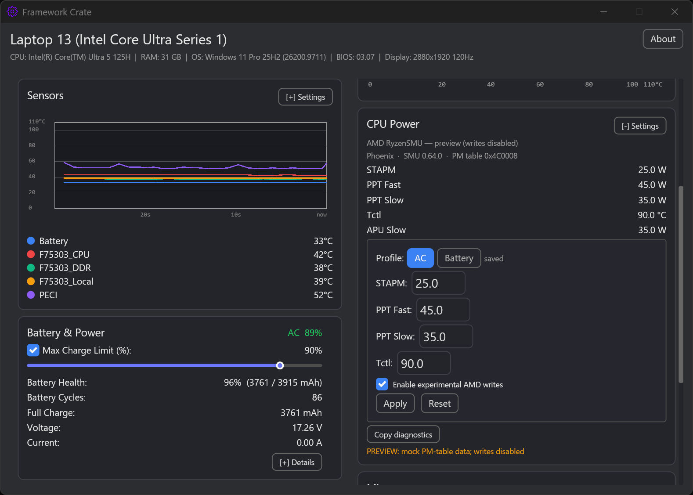

# AMD CPU Power testing

[English](Ryzen_Power_Testing.md) | [繁體中文](Ryzen_Power_Testing.zh-TW.md)

Web version: https://vinctw22.github.io/Framework-Crate/ryzen-testing.html

AMD write support is experimental. Use this checklist to collect comparable results.
Read-only telemetry is safe; writes require **Enable experimental AMD writes** and can
be rejected or clamped by firmware.

**Always keep the charger connected for Stages 0–3.** Only test battery-mode writes
after AC writes are confirmed to work and read back correctly.

## Before testing

- AMD Framework laptop/desktop (supported families: Raven, Renoir, Mobile/Phoenix,
  Strix Point/Krackan, Strix Halo, Raphael/Granite Ridge/Dragon Range).
- Framework Crate 0.9.6 or newer, run as administrator.
- PawnIO + `RyzenSMU.bin` installed via **Download Modules**, then **Redetect**.
- HWiNFO64 in Sensors-only mode (for package power cross-checks).
- CPU-Z for the all-core load (**Tools → Stress CPU**).
- Keep `%APPDATA%\framework-crate\app.log` available for the report.

## Stage 0 — read-only

1. Open **CPU Power**. Confirm the card says `AMD RyzenSMU`.
2. Press **Copy diagnostics** and keep the output.
3. Check that `code_name`, `smu_version`, `pm_table_version`, STAPM/PPT Fast/PPT Slow,
   Tctl, and APU Slow look plausible (not zero/absurd).
4. Compare with HWiNFO64 idle package power and any PPT limit row.
5. Report the diagnostics through the AMD issue template.

## Stage 1 — no-op apply

1. Enable **experimental AMD writes**.
2. Apply the same values that are currently shown.
3. Confirm the command succeeds and the PM-table readback is unchanged.
4. If it fails, stop and report the error text + diagnostics.

## Stage 2 — small delta + readback

1. On AC power, lower STAPM/PPT Fast/PPT Slow by 5W (or Tctl by 2°C); keep everything else.
2. Press **Apply** and confirm the readback matches the request within 1W/1°C.
3. On AC, run CPU-Z **Stress CPU** and record HWiNFO64 package power.
4. Press **Reset** and confirm the captured baseline comes back.
5. Report both the requested values and the readback/HWiNFO results.

## Stage 3 — profiles, keep-alive, transitions

Only run this stage after **Stage 1 (no-op) and Stage 2 (small delta) both succeeded with a
matching readback**. If either fails, stop at Stage 2 and report; do not enable keep-alive
or test sleep/AC transitions until a write is confirmed working.

1. On AC, save the AC profile and enable keep-alive; confirm the AC profile applies.
2. Only then save a distinct Battery profile and verify the switch after unplug/replug.
3. On AC, sleep/resume and verify the profile is re-applied.
4. Repeat once after **Reset** (keep-alive should turn off).
5. Record any unexpected value, error, or fan behavior and the power source used.

## Reporting

Use the **AMD CPU Power test report** issue template and include:

- diagnostics from every stage
- exact values requested and read back
- HWiNFO64 package power before/after (CSV/screenshot if possible)
- a screenshot of CPU-Z **Stress CPU** running alongside HWiNFO64
- sleep/resume and AC/battery observations
- relevant `app.log` lines

Do not include serial numbers, tokens, or other private data. If a write fails or the
machine behaves unexpectedly, press **Reset**, disable the experimental toggle, and
report before trying again.
