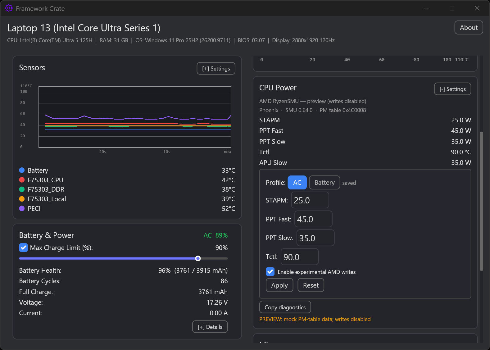

# Ryzen CPU Power 測試

[English](Ryzen_Power_Testing.md) | **繁體中文**

AMD 寫入支援為實驗性。請依照此清單收集可比較的結果。唯讀遙測是安全的；寫入需要開啟
**Enable experimental AMD writes**，且可能被韌體拒絕或夾限。

**Stages 0–3 一律先接上充電器。** 只有 AC 寫入確認可運作且 readback 正確後，才測試電池模式寫入。

## 測試前

- AMD Framework 筆電／桌機（支援 family：Raven、Renoir、Mobile/Phoenix、Strix Point/Krackan、Strix Halo、Raphael/Granite Ridge/Dragon Range）。
- Framework Crate 0.9.6 以上，以管理員身分執行。
- 已透過 **Download Modules** 安裝 PawnIO 與 `RyzenSMU.bin`，並按 **Redetect**。
- HWiNFO64 使用 Sensors-only 模式（交叉比對 package power）。
- CPU-Z 用於全核負載（**Tools → Stress CPU**）。
- 保留 `%APPDATA%\framework-crate\app.log` 供回報使用。

## Stage 0 — 唯讀

1. 開啟 **CPU Power**，確認卡片顯示 `AMD RyzenSMU`。
2. 按 **Copy diagnostics** 並保留輸出。
3. 檢查 `code_name`、`smu_version`、`pm_table_version`、STAPM／PPT Fast／PPT Slow、Tctl、APU Slow 是否合理（不是零或誇張值）。
4. 與 HWiNFO64 的 idle package power、PPT limit 欄位比對。
5. 使用 AMD issue template 回報 diagnostics。

## Stage 1 — no-op apply

1. 勾選 **experimental AMD writes**。
2. 套用目前顯示的相同數值。
3. 確認命令成功，且 PM-table readback 沒有改變。
4. 若失敗，停止並回報錯誤文字＋diagnostics。

## Stage 2 — 小幅調整＋readback

1. 在 AC 下把 STAPM／PPT Fast／PPT Slow 降低 5W（或 Tctl 降低 2°C），其餘不變。
2. 按 **Apply**，確認 readback 與要求值誤差在 1W／1°C 內。
3. 在 AC 下執行 CPU-Z **Stress CPU**，記錄 HWiNFO64 package power。
4. 按 **Reset**，確認擷取的 baseline 回來。
5. 回報要求值與 readback／HWiNFO 結果。

## Stage 3 — profiles、keep-alive、狀態切換

只有 **Stage 1（no-op）與 Stage 2（小幅調整）都成功且 readback 相符**後才可進行此階段。
任一失敗請停在 Stage 2 回報；在確認寫入可運作前，不要開啟 keep-alive 或測試睡眠／AC 切換。

1. 在 AC 下儲存 AC profile 並開啟 keep-alive；確認 AC profile 有套用。
2. 之後才儲存不同的 Battery profile，並在插拔後確認切換。
3. 在 AC 下睡眠／喚醒，確認 profile 有重新套用。
4. 按一次 **Reset**（keep-alive 應關閉）後再重複一次。
5. 記錄任何異常數值、錯誤或風扇行為，以及當下電源狀態。

## 回報

使用 **AMD CPU Power test report** issue template，並附上：

- 每個階段的 diagnostics
- 要求的精確數值與 readback
- HWiNFO64 package power 前後對照（CSV／截圖）
- CPU-Z **Stress CPU** 搭配 HWiNFO64 的截圖
- 睡眠／喚醒與 AC／電池觀察
- 相關 `app.log` 行

請勿包含序號、token 或其他私人資料。若寫入失敗或機器行為異常，請按 **Reset**、關閉
experimental 開關，然後再回報。
